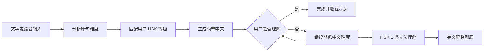

# -2026-International-AI-Hackathon-
# Peng — SinoStudy Copilot

> **复杂交给机器，清晰留给人。**  
> Leave complexity to AI, and clarity to people.

**Peng** 是一款面向来华留学生的中文理解助手。它不急着把中文翻译成英文，而是先根据用户的中文水平，将复杂表达改写成更容易理解、更加清晰的中文；如果用户仍然无法理解，再逐级降低难度，最后提供英文解释。

我们的目标不是替代中文教师，而是帮助留学生在课堂之外，随时看懂中国人真实使用的中文。

---

## 项目背景

留学生即使学过中文，也经常无法理解真实生活中的表达：

> “您这个套餐目前办不了携号转网，得先去营业厅把副卡注销了。”

困难不仅来自生词，还来自：

- 复杂句式与省略表达
- 生活场景中的专有词汇
- 中文特有的表达习惯
- 说话速度与信息密度
- 学习材料与真实中文之间的差距

普通翻译工具通常直接输出英文，却容易中断用户的中文思维。Peng 尝试在“完全不懂”和“直接翻译”之间，搭建一座可以逐级理解的桥梁。

---

## 核心功能

### 1. 分级中文改写

用户可以选择 HSK 1–6 的目标理解等级。系统首先判断原句难度，再将内容改写成符合用户当前水平的中文。

原文并不固定属于最高难度，它可能本身就是 HSK 1–6 中的某一级。

### 2. 八级理解阶梯

Peng 使用以下理解路径：

```text
原文
 ↓
HSK 6
 ↓
HSK 5
 ↓
HSK 4
 ↓
HSK 3
 ↓
HSK 2
 ↓
HSK 1
 ↓
English


系统不会要求用户每次都从最高等级开始，而是根据原文难度和用户水平，选择合适的起点。

### 3. “还不懂”继续降级

第一轮将复杂中文改写成清晰、简单的中文。

如果用户仍然无法理解，可以点击“更简单”或“不懂”，系统继续降低表达难度。只有在简单中文仍无法解决问题时，才提供英文解释。

### 4. 原文与改写对照

网页端同时展示：

- 原始中文
- 目标等级的中文改写
- 重点词语与拼音
- 文化或生活语境说明
- 英文兜底解释

用户不仅能得到答案，也能知道原句是怎样被理解和拆解的。

### 5. 文字与语音交互

当前版本支持：

- 中文文字输入
- 浏览器语音输入
- 中文语音播报
- 多轮“继续简化”交互
- 基础会话记录

项目也可接入带显示屏、麦克风和扬声器的语音硬件。目前硬件主要实现带有一定延迟的基础语音问答，不将其描述为实时同传设备。

---

## 使用示例

### 原句

> 您这个套餐目前办不了携号转网，得先去营业厅把副卡注销了。

### HSK 4 改写

> 你现在不能把这个号码转到另一家公司。请先去营业厅取消副卡。

### HSK 2 改写

> 你的电话卡现在不能换公司。你先去营业厅，关掉第二张卡。

### English fallback

> You can’t transfer this phone number yet. First go to a service center and cancel the secondary SIM.

Peng 在简化语言的同时，尽可能保留“先处理副卡，再办理转网”的行动顺序和原始含义。

---

## 产品流程



人物关系、使用场景和前后文等信息均为可选输入。用户可以直接输入一句话获得即时解释，也可以补充语境以获得更严谨的结果。

---

## 技术架构

```text
网页端 / 基础语音硬件
          │
          ▼
文字输入 / ASR 语音识别
          │
          ▼
callPeng(request)
          │
          ▼
扣子 Coze 智能体工作流
          │
          ├── 原句难度判断
          ├── HSK 等级匹配
          ├── 语义保真改写
          ├── 关键词与语境解释
          └── 英文兜底
          │
          ▼
结构化 JSON 响应
          │
          ▼
网页展示 / TTS 语音播报
```

### 主要技术

- **智能体与工作流：** 扣子 Coze
- **模型能力：** 中文难度判断、分级改写、语境解释
- **前端交互：** Web
- **语音输入：** Web Speech API / ASR
- **语音输出：** Speech Synthesis / TTS
- **硬件扩展：** 带屏语音终端

---

## 当前完成度

### 已实现

- [x] 中文文字输入
- [x] HSK 目标等级选择
- [x] 复杂中文转简单中文
- [x] 原文与改写结果对照
- [x] “仍不理解”后的英文兜底
- [x] 扣子智能体工作流
- [x] 基础网页交互原型

### 正在接入

- [ ] 浏览器语音输入与播报优化
- [ ] 网页端与扣子工作流完整联调
- [ ] 基础语音硬件接入
- [ ] 多轮会话状态管理

### 后续路线图

- [ ] 自动识别用户中文水平
- [ ] 真实对话复盘与表达收藏
- [ ] 个性化学习记录和能力图谱
- [ ] 文化语境与“言外之意”解释
- [ ] 更低延迟的硬件交互
- [ ] 扩展至其他语言的分级理解场景

---

## 项目价值

### 全天候使用

Peng 可以在教师不在场时，为留学生提供即时的中文理解支持。

### 可规模化

同一套智能体能够服务不同中文水平、不同生活场景的用户。

### 保持中文思维

系统优先使用简单中文解释复杂中文，英文只作为最后的安全兜底。

### 积累学习数据

随着使用次数增加，系统可以逐步积累用户经常遇到的词汇、表达和场景，为后续个性化学习提供基础。

### 连接真实生活

Peng 关注的不只是考试题目，还包括校园交流、打车、购物、通信业务、医院、餐厅和行政办事等真实场景。

---

## 与普通翻译工具的区别

| 能力 | 普通翻译工具 | Peng |
|---|---:|---:|
| 直接翻译成英文 | ✓ | 仅作为兜底 |
| 中文解释中文 | 部分支持 | ✓ |
| 按 HSK 等级改写 | 通常不支持 | ✓ |
| 用户不懂时继续降级 | 通常不支持 | ✓ |
| 保留中文学习过程 | 较弱 | ✓ |
| 文化与生活语境解释 | 不稳定 | ✓ |
| 接入网页与语音硬件 | 视产品而定 | ✓ |

Peng 不与通用大模型比“能否回答”，而是通过固定的分级路径、交互界面和学习闭环，让模型能力真正适配来华留学生。

---

## 项目结构

```text
.
├── README.md
├── SSC工作流/          # 扣子智能体与工作流相关文件
├── frontend/           # 网页端代码（如已上传）
├── assets/             # 图片、界面截图与演示资源
└── docs/               # 产品及技术文档
```

> 实际目录以仓库当前文件为准。

---

## 运行与体验

1. 导入或配置 `SSC工作流` 中的扣子工作流。
2. 配置模型、语音服务及所需 API 凭证。
3. 启动网页端项目。
4. 选择目标 HSK 等级。
5. 输入或说出需要理解的中文。
6. 查看分级改写结果。
7. 如果仍然不懂，继续降低难度或查看英文解释。

> 请勿将 API Key、Token 等敏感信息直接提交到公共仓库。

---

## 团队

**团队名称：Ctrl+Alt+Culture**

我们是一支由中国学生与国际学生共同组成的跨文化团队。项目源于留学生在中国真实生活中遇到的沟通问题。

团队希望通过 AI，让语言学习不再停留在教材中，而是进入每一次真实交流。

---

## 产品信息

- **产品名称：** Peng
- **英文副标：** SinoStudy Copilot
- **产品定位：** 面向来华留学生的分级中文理解助手
- **Slogan：** 复杂交给机器，清晰留给人
- **参赛项目：** 2026 国际人工智能黑客松

---

## License

本项目当前用于黑客松参赛展示与教育研究。未经团队许可，请勿直接用于商业用途。
